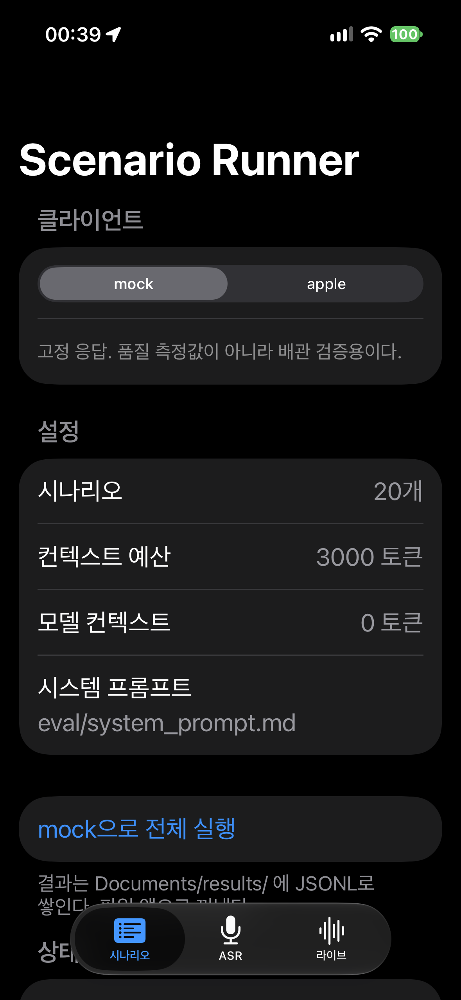

# Pocket Talk — 온디바이스 타당성 스파이크 결과 리포트

- 작성: 2026-10-27 (에이전트)
- 범위: `TASKS.md` M0–M4, §1–§7 중 **실행 완료된 부분 전부**
- 원칙: 실행해서 출력을 본 것만 "통과"로 적었다. 실행하지 않은 항목은 "미실행"으로 남겼다.

## 0. 한 장 요약

> **질문**: 아이폰 온디바이스 모델로 초중급 일상회화 연습이 되는가?
>
> **측정 결과**: 문법·사실성은 충분하다(정확성 4.58/5, 지어냄 0%). 그러나
> ① "받아들일 만함"이 클라우드 대비 **63% vs 95%**로 기준(70%)에 못 미치고,
> ② 발화 종료 → 음성 시작이 **p50 2,545ms**로 1.5초 기준을 48턴 전부 초과했다.
> 음성 인식은 WER 4.8%(어휘 기준 2.7%)로 양호했다.
>
> **남은 판단**: 지연 기준을 2.5초로 재협의할지, 애플 클라우드(PCC)로 백엔드를 바꿀지.

| 항목 | 기준 (TASKS.md) | 측정 | 판정 |
| --- | --- | --- | --- |
| 대화 품질 | 클라우드 대비 70% | **63%** (12/19) | **미달(점추정)** |
| 문법·사실성 | "거의 없음" | 정확성 4.58, 지어냄 0% | 충족 |
| 컨텍스트 | 30턴 유지 | 34턴 8/8 (정책 64) | 충족(정책 의존) |
| 음성 인식 | 지장 없는 WER | **4.8%** (어휘 2.7%) | 충족(1조건) |
| 지연 | 1.5초 이내 | **2,545ms** (48/48 초과) | **미달(구조적)** |
| 지속성 | 30분 무중단 | 13분 무변화 | 부분 |

---

## 1. 질문과 판정 기준

`TASKS.md`가 정의한 목표와 기준을 그대로 쓴다.

| 항목 | 통과 기준 |
| --- | --- |
| 대화 품질 | 블라인드 평가에서 클라우드 모델 대비 "받아들일 만함" 70% 이상, 문법 틀린 영어 거의 없음 |
| 컨텍스트 | 30턴 이상에서 주제/앞 내용을 놓치지 않음 |
| 음성 인식 | 한국인 억양 샘플의 WER이 대화 진행에 지장 없는 수준 (기준값은 §3에서 합의) |
| 지연 | 발화 종료 → AI 음성 시작 1.5초 이내 (이상적 1초 안팎) |
| 지속성 | 30분 세션에서 발열로 중단/성능 저하 없음 |

---

## 2. 방법

### 2.1 환경

| 항목 | 값 |
| --- | --- |
| Xcode / SDK | Xcode 27.1, iOS SDK 27.1, Swift 6.4 |
| 개발 머신 | macOS 27.0.1 (arm64) |
| 시뮬레이터 | iPhone 16 (iOS 27.0 런타임) — Mac Apple Intelligence로 온디바이스 모델 사용 가능 |
| 실기기 | **iPhone 16 (iPhone17,3), iOS 27.0.1 (24A446)**, Apple Intelligence + Siri 영어 |
| 기기 컨텍스트 | **4,096 토큰** (시뮬레이터는 8,192) |
| 서명 | Apple Development, team `M9N98B9A3K` |



### 2.2 구성

- `Package/PocketTalkCore` — 순수 로직 + 모델 클라이언트 (Swift 6, 유닛테스트 32개)
- `App/PocketTalkSpike` — SwiftUI 측정 앱, 3탭 (시나리오 / ASR / 라이브)
- `eval/` — 시나리오 20개, 시스템 프롬프트, 평가 스크립트, 원본 JSONL

모델 호출은 전부 `LanguageModelClient` 프로토콜 뒤에 있다.

| 클라이언트 | 용도 |
| --- | --- |
| `MockLanguageModelClient` | 배관 검증 (고정 응답) |
| `AppleOnDeviceClient` | Foundation Models 온디바이스 (스트리밍, 실측 토큰) |
| `AppleOnDeviceReusableClient` | 세션 재사용 A/B 실험용 |
| `eval/run_compare.py` | Ollama 로컬 / Ollama Cloud / OpenAI / Anthropic |

### 2.3 측정 장치

앱이 모든 측정을 JSONL로 남기고, Mac에서 `devicectl`로 회수한다.

```
Documents/results/
  scenarios-apple-*.jsonl   시나리오 턴별 응답·지연·실측 토큰
  asr-*.csv                 문장별 정답/인식/WER
  live-*.jsonl              라이브 턴별 3구간 지연 + 세션 배터리/발열
  long-*.jsonl              34턴 컨텍스트 정책 비교
  cache-experiment-*.jsonl  세션 재사용/프롬프트 크기 A/B
```

기기 실행은 무료 프로파일 앱 슬롯 제한 때문에 UI 테스트 대신 `--autorun-*` 인자를 쓴다.

```sh
xcrun devicectl device process launch --device <UDID> --terminate-existing \
  dev.pockettalk.spike -- --autorun-apple
```

---

## 3. 대화 품질 (블라인드 평가)

### 3.1 설계

- 20개 시나리오 × 4턴을 4개 모델에 동일한 시스템 프롬프트로 실행
- 마지막 AI 응답을 모델명 없이 섞어 79행 생성 (`blind_key.csv`는 채점 후까지 봉인)
- 채점 항목: 자연스러움·정확성·레벨(1–5), 사실 지어냄(y/n), **받아들일 만함(y/n)**
- **채점 주체: AI 1개 모델** (사람 아님). 20행은 프롬프트를 두 번 실행해 중복 채점

### 3.2 결과

| 모델 | n | 자연스러움 | 정확성 | 레벨 | 지어냄 | **받아들일 만함** |
| --- | --- | --- | --- | --- | --- | --- |
| `gpt-oss:120b` (클라우드 기준선) | 20 | 3.65 | 4.85 | 4.50 | 0% | **95%** (19/20) |
| `qwen2.5:3b` | 20 | 3.15 | 4.75 | 4.85 | 5% | 65% (13/20) |
| **`apple_ondevice` (실기기)** | 19 | **2.79** | 4.58 | 4.89 | **0%** | **63%** (12/19) |
| `llama3.2:3b` | 20 | 2.90 | 4.50 | 4.45 | 0% | 55% (11/20) |

- 애플 95% 신뢰구간 **41–81%** (n=19) → 70%와 통계적으로 구분되지 않는다.
- 클라우드 19/20 (76–99%).

### 3.3 애플이 깎인 이유: 문법이 아니라 "회피"

정확성 4.58·레벨 4.89·지어냄 0%로 오히려 높다. 실패 7건은 전부 대화 지속성 문제였다.

| 시나리오 | 관찰 |
| --- | --- |
| 약국 | 약사가 "I don't know"만 반복 |
| 쇼핑 | 점원이 모른다고만 함 |
| 취미 | 맥락에 안 맞는 "I don't know" |
| 헬스장 | 모른다고 하고 되묻기만 |
| 대중교통 | `Station A` 자리표시자 |
| 카페 | 결제 확인 후 다른 음료를 물음 |
| 길 묻기 | "Is today busy?" |

### 3.4 채점 신뢰도

- 중복 20행에서 `받아들일 만함` **20/20 일치**
- 5개 항목 전부 동일 14/20, 나머지 6건은 자연스러움 1점 차이

---

## 4. 음성 인식 (SpeechAnalyzer)

- 기기에서 29문장(30개 중 s05 누락), **조용한 곳 1조건**, 사용자가 직접 낭독
- 정규화: 소문자, 아포스트로피 제거, 구두점 → 공백

| 항목 | 값 |
| --- | --- |
| 전체 WER | **4.8%** (14/294) |
| 숫자 표기 차이 | 6건 (seven→7, third→3rd 등) |
| **어휘 WER** | **2.7%** (8/294) |
| 완전 일치 | 20/29 |

실제 오류 4문장: `crowded→clouded`, `Let's meet→That's meat`, `order a large→auto a lousy`,
`nearest→main list` — 연속 발화 경계와 유사 음 형용사.

**미실행**: 걷기 / 이어폰 조건, 다중 화자.

---

## 5. 지연

### 5.1 라이브 세션 48턴 (실기기, 13분 7초)

| 구간 | p50 | p90 | max |
| --- | --- | --- | --- |
| 인식 (버튼 → 최종 텍스트) | **69ms** | 101ms | 142ms |
| 모델 첫 토큰 (발화 종료 기준) | **2,219ms** | — | — |
| TTS 시작 (첫 토큰 이후) | **358ms** | — | — |
| **발화 종료 → 음성 시작** | **2,545ms** | 2,966ms | 4,445ms |

- **1.5초 초과: 48/48 (100%)**, 최소 1,920ms
- 대화가 길어질수록 증가: 1~10턴 2,011ms → 39~48턴 2,935ms (입력 403 → 1,404토큰)
- 33턴부터 컨텍스트 접힘 시작

### 5.2 원인 규명 실험

| 실험 | 결과 |
| --- | --- |
| 세션 재사용 (vs 턴마다 새 세션) | p50 1,824 vs 1,746ms, **캐시 토큰 양쪽 0** → 효과 없음 |
| 시스템 프롬프트 22% 축소 (415→325토큰) | 첫 토큰 1,395 → **1,314ms** (80ms) → 미미 |

첫 토큰까지 **약 1.3초의 고정 오버헤드**가 있고, 프리필 토큰 수가 지배 변수가 아니다.
하한 추정 **1.74초** (첫 토큰 1.31 + TTS 0.36 + 인식 0.07). 1.5초는 이 스택에서 달성 불가.

---

## 6. 컨텍스트 (34턴 가상 대화)

같은 34턴 스크립트(사실 8개 심음)를 정책만 바꿔 실행.

| 정책 | 기억 성공 | 요약 시작 | 최대 입력 |
| --- | --- | --- | --- |
| 요약 없음 | **8/8** | 없음 | 1,541 |
| **기본 64 (채택)** | **8/8** | 32턴 | 1,510 |
| 요약 8턴 (이전 기본) | **1/8** | 4턴 | 538 |
| 요약 700 | 2/8 | 4턴 | 562 |

원인: `ExtractiveSummarizer`가 400자를 넘으면 **최신만 남기고 앞을 버려서**, 요약이 최근 4~5턴으로 미끄러진다.
실패 7건 전부 "요약에 사실이 없음"이었다(모델이 요약을 무시한 경우 0건).

**중간 실험(24턴)**: 5/8, 그리고 여동생 이름을 `Mina` → **`Minsoo`**로 지어냈다.
현재 정책(64)에서는 재현되지 않았다.

채택 변경: `ContextPolicy` 기본값 `7,000 / 64`, 앱 예산 7,000 (기기에서는 context−512로 캡).

---

## 7. 지속성

| 항목 | 값 |
| --- | --- |
| 세션 길이 | 13분 7초 / 48턴 |
| 배터리 | 100% → 100% |
| thermalState | nominal → nominal (전 턴) |
| 발열로 인한 중단 | 없음 |

**미실행**: 30분 세션, 이어폰/스피커 각 1회. 배터리가 양 끝 100%라 충전 중이었을 가능성을 배제하지 못한다.

---

## 8. 사고 및 버그 (수정 완료)

### 8.1 실기기 크래시 2건

| # | 증상 | 원인 | 수정 |
| --- | --- | --- | --- |
| 1 | 첫 ASR 녹음 시작 직후 종료 | `installTap` 클로저가 MainActor 격리를 상속 → 오디오 실시간 스레드에서 `_dispatch_assert_queue_fail` | `@Sendable` 클로저로 nonisolated |
| 2 | 두 번째 녹음에서 종료 | `SpeechTranscriber` 인스턴스를 새 `SpeechAnalyzer`에 재사용 → Speech 내부 assertion | 세션마다 새 transcriber/analyzer |

두 건 모두 실기기에서만 재현됐다(시뮬레이터는 ASR 미지원).

### 8.2 가드레일 거부 (재현 2/2)

`sc18_bank` 2번째 턴에서 `May contain unsafe content`. 시뮬레이터·실기기 동일 지점.

### 8.3 채점 시트 유실 (1회)

블라인드 시트를 재생성하면서 이미 채점된 4행이 지워졌다. 이후 `build_blind_sheet.py`가
채점된 행이 있으면 재생성을 거부하도록 가드를 추가했다.

---

## 9. 통과 / 미달 / 미실행 총표

| # | 항목 | 상태 | 근거 |
| --- | --- | --- | --- |
| M0 | 환경 확인 | **통과** | Xcode 27.1, 시뮬레이터 확정 |
| M1 | 코어 패키지 | **통과** | `swift test` 32/32 |
| M2 | 앱 골격 | **통과** | 빌드 + UI 테스트 |
| M3 | Apple 모델·Speech·TTS | **에이전트 완료** | 실기기 실행 확인, 실기기 HUMAN 검증 일부 |
| M4 | 실기기 측정 | **부분** | 시나리오/ASR/라이브 완료, 30분·이어폰 미실행 |
| §1 | 시나리오 20개 | **통과** | 사용자 검수 완료 |
| §2 | 모델 비교 | **통과(AI 채점)** | 79행, `eval/summary.md` |
| §3 | ASR | **부분** | 1조건 29문장 |
| §4 | 온디바이스 실측 | **통과** | 19/20, 컨텍스트 4,096 |
| §5 | 컨텍스트 | **통과(에이전트)** | 34턴 4정책 |
| §6 | 지연 | **미달** | 48/48 초과 |
| §6 | 발열·배터리 | **부분** | 13분 |
| §7 | 판정 초안 | **통과** | `eval/verdict.md` |

---

## 10. UNVERIFIED

- 대화 품질은 **사람이 아니라 AI 1개**가 채점했다. TASKS.md가 요구한 사람 블라인드 평가가 아니다.
- Apple n=19, 신뢰구간 41–81%로 넓다.
- ASR은 **조용한 곳 1조건, 화자 1명**. 걷기/이어폰은 없다.
- 지속성은 30분이 아니라 13분이다.
- 기기의 `contextSize`는 Apple Intelligence 설정 전 0, 후 4,096이었다. 준비 상태에 따라 달라지는지 미확인.
- 두 번째 AI 또는 사람 채점과의 교차 검증이 없다.

---

## 11. 다음 단계

1. **애플 클라우드(PCC) 확인** — SDK에 `PrivateCloudComputeLanguageModel`이 존재(iOS 27).
   `availability`·`quotaUsage`를 기기에서 확인하고, 가용하면 같은 20개 시나리오로 품질/지연 비교.
   서드파티 API는 사용하지 않는다(요청당 과금 배제).
2. **30분 세션 + 이어폰/스피커** — 지속성 칸 채우기.
3. **TTS 문장 단위 스트리밍** (선택) — 0.3~0.5초 추가 절감. 하한은 여전히 1.7초대.
4. **최종 판정** — `eval/verdict.md` §4의 세 선택지 중 하나. 지연 기준 재협의(2.5초)가 핵심 쟁점.

---

## 부록 A. 파일 지도

| 경로 | 내용 |
| --- | --- |
| `.replworks/TASKS.md` | 작업 목록·완료 조건 |
| `eval/verdict.md` | 판정 초안 (결론란 비움) + 방향 결정 |
| `eval/summary.md` | 블라인드 집계 |
| `eval/asr_summary.md` | WER 집계 |
| `eval/results/` | 원본 JSONL/CSV |
| `reports/` | 마일스톤별 실행 기록 (M0–M3, §2–§6) |
| `reports/assets/` | 시뮬레이터·실기기 화면 캡처 |

## 부록 B. 재현 명령

```sh
# 코어 테스트
cd Package/PocketTalkCore && swift test

# 앱 빌드 (시뮬레이터)
cd App/PocketTalkSpike && xcodegen generate
xcodebuild -scheme PocketTalkSpike \
  -destination "platform=iOS Simulator,name=iPhone 16 (iOS 27),OS=27.0" build

# 기기 실행 (autorun)
xcrun devicectl device install app --device 00008140-001243C93A3A801C <app>
xcrun devicectl device process launch --device 00008140-001243C93A3A801C \
  --terminate-existing dev.pockettalk.spike -- --autorun-apple

# 결과 회수
xcrun devicectl device copy from --device 00008140-001243C93A3A801C \
  --domain-type appDataContainer --domain-identifier dev.pockettalk.spike \
  --source Documents/results --destination /tmp/device-results

# 집계
python3 eval/compute_wer.py --input <asr.csv> --out eval/asr_summary.md
python3 eval/score_summary.py
```
